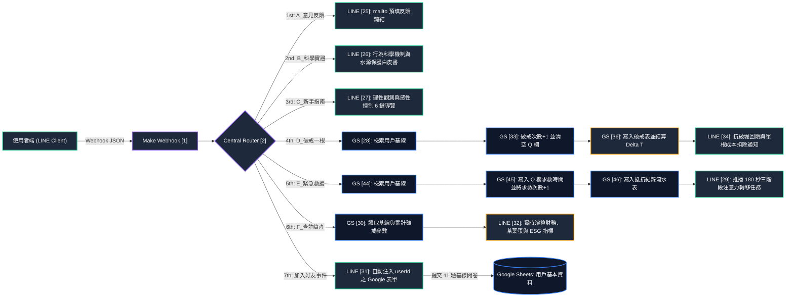

# Nicotine Free：基於行為經濟學之習慣追蹤與機會成本量化系統
> 結合數位推力（Digital Nudge）、衝動延遲時差演算（Delta T）與 ESG 指標折算之無狀態非同步 LINE 行為觀測系統

**License:** MIT | **Architecture:** Serverless Event-Driven (LINE Messaging API + Make + Google Sheets) | **Domain:** Behavioral Economics & Habit Tracking

---

### 線上實機互動體驗 (Live Demo & Sandbox)
本系統目前處於 24/7 雲端自動化運行狀態。欲體驗「去識別化 UserID 自動注入問卷」、「180 秒危機阻斷任務」與「即時多巴胺資產演算」之完整資料流，請透過下列方式加入官方測試帳號：

- **方式一（手機直接點擊跳轉）**：[點此開啟 LINE 加入好友 (@706rzcae)](https://line.me/R/ti/p/@706rzcae)
- **方式二（電腦端掃描 QR Code）**：
  

    
<b>點此展開 / 收合 QR Code 行動條碼</b>

     
    
     
  

     
    <i>請使用智慧型手機 LINE 相機掃描上方條碼加入好友</i>
  

- **方式三（LINE ID 搜尋）**：於 LINE 應用程式新增好友處搜尋 `@706rzcae`

> **測試流程指引**：加入好友後，系統將透過 Webhook 自動派發已嵌入專屬去識別化 `UserID` 之初始問卷連結；完成 11 題基線參數設定後，即可透過聊天室下方 6 宮格圖文選單（Rich Menu）進行實時互動觀測。
---

### 法律合規與非醫療性質聲明 (Legal & Non-Medical Disclaimer)
1. **非醫療器材與非醫療行為聲明**：本專案（Nicotine Free）純屬「個人日常習慣追蹤、行為經濟學機會成本量化與資訊工程架構展示」之軟體作品。本系統不具備任何疾病診斷、治療、減輕或預防之醫療效能，亦非屬中華民國《醫療器材管理法》所定義之醫用軟體（SaMD），不涉及任何《藥事法》第 69 條所稱之醫療效能標示或宣傳。
2. **量表引用之學術分群用途**：系統初始問卷所引用之國際開源文獻「芳斯頓習慣依賴度量表（FTND）」，於本專案中僅作為後端資料庫之「基線習慣強度分群標籤（Stratification Feature）」，旨在校正不同使用頻率群體之數據基準線，絕不構成臨床醫學診斷。
3. **無涉菸品與藥物推廣**：本專案嚴格遵守《菸害防制法》，系統內無任何菸品、類菸品或戒菸藥物之廣告、推薦與導購行為。若使用者有臨床戒菸或醫療諮詢需求，請洽詢專業醫療院所或國民健康署戒菸專線。

---

### 專案摘要 (TL;DR)
傳統針對高頻不良消費習慣（如吸菸行為）之宣導多仰賴「健康恐懼訴求（Fear Appeal）」，易引發大腦防衛機制與視覺疲勞；且在習慣重塑過程中，單次失控極易觸發心理學上的「破堤效應（Abstinence Violation Effect, AVE）」，導致受挫放棄。

本獨立開發專案建構一套「零下載摩擦力、去識別化」之無狀態事件驅動系統。透過 LINE 官方帳號作為前端互動探針，以 Make.com 作為中央非同步路由編排器（Orchestrator），並將 Google Sheets 建構為關聯式雲端資料庫。系統核心不採取道德規訓，而是藉由捕捉使用者於「衝動產生（SOS）」至「實際消費（Relapse）」之間的世界標準時間差（$\Delta T$），將抽象的克制行為即時轉化為**個人財務儲蓄、時間機會成本（茶葉蛋物資當量）**以及**環境永續指標（GRI 303 保全水體與 GRI 305 減碳當量）**，驗證「實時數位推力」對拉長衝動延遲時間之量化成效。

---

## 1. 核心動機與行為科學痛點 (Project Motivation & Pain Points)

### 1.1 恐懼訴求的邊際效用遞減與跨期選擇偏誤
依據行為經濟學之「雙曲折現（Hyperbolic Discounting）」理論，人類大腦對「當下立即的感官回饋」賦予極高權重，而對「數十年後的健康風險」進行大幅度折現。因此，強調長期健康危害的傳統衛教難以在衝動爆發的毫秒間產生行為阻斷效果。

### 1.2 破堤效應（Abstinence Violation Effect）之數據防禦
在習慣改變過程中，傳統紀錄工具常將「單次破戒」視為「全面失敗（時間軸歸零）」。此種全有全無（All-or-Nothing）的計分方式會引發強烈罪惡感與認知失調，反而促使當事人徹底放棄控制。本系統透過演算法重構回饋機制：**破戒僅扣除單單位邊際成本，而累計堅持總時數持續推進永不歸零**，並進一步計算該次破戒前成功忍耐之分鐘數（$\Delta T$），將「失敗紀錄」轉化為「延遲控制力之量化觀測」。

### 1.3 零摩擦力與去識別化追蹤（Zero-Friction & De-identification）
要求使用者下載獨立 App 與註冊實名帳號具備極高之轉換摩擦力。本系統利用民眾日常高頻使用之 LINE 介面，結合 URL Query Parameter 自動預填（Pre-fill）技術，在使用者掃描 QR Code 加入好友並點擊 Google 表單的瞬間，即自動綁定 LINE 內部去識別化雜湊碼（`source.userId`），全程零個資採集（不收集姓名、電話、電郵），達成高隱私安全與極低介入摩擦力。

---

## 2. 無狀態非同步系統架構設計 (System Architecture)

本系統採用事件驅動（Event-Driven）之三層式無伺服器架構：前端為 LINE Messaging API（含 6 宮格圖文選單 Rich Menu），中繼層為 Make.com 7 軌條件路由器，儲存與運算層為 Google Sheets 關聯工作表。

### 全系統事件路由與資料流向圖

### 圖文選單（Rich Menu）雙維度功能矩陣

系統將聊天室下方之 6 顆常駐互動按鈕，依認知心理學劃分為「理性觀測」與「感性控制」兩大模組：

| 模組分類 | 路由分支與節點編號 | 觸發條件 | 後端資料表操作與核心回應機制 |
| :--- | :--- | :--- | :--- |
| **初始化軌** | **7th: 加入好友填表單** (`LINE [31]`) | `follow` 事件 | 攔截加入好友事件，自動將 `1.events[]:source.userId` 拼接至 Google Forms 預填網址（`?usp=pp_url&entry.778372188=`），實現無感帳號綁定。 |
| **理性觀測** | **1st: A_意見反饋** (`LINE [25]`) | 點擊「意見反饋」 | 零資料庫讀寫。回傳經 URL-encoded 編碼之 `mailto:` 協定連結，自動喚起手機原生郵件信箱並預填主旨與內文。 |
| **理性觀測** | **2nd: B_科學實證** (`LINE [26]`) | 點擊「科學解密」 | 零資料庫讀寫。提供行為科學注意力重塑機制說明、單根菸蒂對 $1,000\text{ L}$ 水體之環境影響數據及專案白皮書連結。 |
| **理性觀測** | **3rd: C_新手指南** (`LINE [27]`) | 點擊「新手上手」 | 零資料庫讀寫。說明表單數據串接邏輯，以及理性觀測／感性控制六大功能鍵之操作規範。 |
| **感性控制** | **5th: E_緊急救援** (`GS [44]->[45]->[46]->LINE [29]`) | 點擊「SOS 我想抽」 | 1. 檢索《用戶基本資料》對應列。 2. 於 Q 欄覆寫當下時間戳記（$T_{\text{SOS}}$），並將 R 欄（求救次數）$+1$。 3. 於《用戶抵抗紀錄》新增流水紀錄。 4. 回傳「180 秒危機阻斷任務」（冷水潛水反射、4-7-8 呼吸法、10 下深蹲肌力代償）。 |
| **感性控制** | **4th: D_破戒一根** (`GS [28]->[33]->[36]->LINE [34]`) | 點擊「破戒一根」 | 1. 檢索《用戶基本資料》對應列。 2. 將 P 欄（破戒次數）$+1$，並以 `{{erase}}` 清空 Q 欄完成狀態機閉環。 3. 於《用戶破戒紀錄》計算並寫入本次抵抗分鐘數 $\Delta T$。 4. 回傳抗破堤安撫訊息（強調堅持時間軸不歸零，僅動態扣除單根產值）。 |
| **感性控制** | **6th: F_查詢資產** (`GS [30]->LINE [32]`) | 點擊「查詢個人資產」 | 檢索《用戶基本資料》之時間戳記、日均量、菸價、時薪與破戒次數，於 Make 記憶體內實時演算堅持時數、商務價值與綠色貢獻並回傳報告。 |

---

## 3. 核心演算法與行為經濟學數學模型 (Mathematical Modeling)

本系統捨棄靜態查表，所有資產數據均於使用者觸發查詢或事件當下，透過 Unix Epoch 秒數（`"X"`）進行高精度動態推導。

### 3.1 衝動延遲時間差演算法（Impulse Delay Latency, $\Delta T$）

當使用者產生消費衝動並點擊【SOS 我想抽】時，系統記錄求救時間 $T_{\text{SOS}}$；若後續仍點擊【破戒一根】（時間為 $T_{\text{relapse}}$），系統於 `Google Sheets [36]` 執行以下閉環狀態演繹：

$$\Delta T = \begin{cases} \left\lfloor \dfrac{\text{Unix}(T_{\text{relapse}}) - \text{Unix}(T_{\text{SOS}})}{60} \right\rfloor \text{ (單位：分鐘)}, & \text{若 } T_{\text{SOS}} \neq \varnothing \\ \text{"未按SOS直接破戒"}, & \text{若 } T_{\text{SOS}} = \varnothing \end{cases}$$

結算完成後，系統立即清空用戶主表之 $T_{\text{SOS}}$ 狀態（設為 $\varnothing$），確保每一次 $\Delta T$ 皆精確反映單一衝動回合之真實抵抗時長。

### 3.2 動態減量基線與「透支警示機制（Loss Aversion Trigger）」

設使用者完成初始問卷之基準時間為 $T_0$，當前查詢時間為 $T_{\text{now}}$，問卷填報之日均消費根數為 $C_{\text{daily}}$，系統累計破戒次數為 $N_{\text{relapse}}$：

1. **累計堅持總秒數（$\Delta t_{\text{sec}}$）**：
   $$\Delta t_{\text{sec}} = \text{Unix}(T_{\text{now}}) - \text{Unix}(T_0)$$
   換算為顯示格式：$\text{Hours} = \lfloor \Delta t_{\text{sec}} / 3600 \rfloor$，$\text{Minutes} = \lfloor (\Delta t_{\text{sec}} \bmod 3600) / 60 \rfloor$。

2. **淨減量根數（$N_{\text{saved}}$）**：
   $$N_{\text{saved}} = \text{round}\left( C_{\text{daily}} \times \frac{\Delta t_{\text{sec}}}{86400} - N_{\text{relapse}} \right)$$
   * **行為經濟學透支防禦特性**：若使用者於短期內密集破戒，使得 $N_{\text{relapse}} > C_{\text{daily}} \times (\Delta t_{\text{sec}} / 86400)$，則 $N_{\text{saved}}$ 與後續財務指標將自動轉為**負值**。此設計直接觸發展望理論（Prospect Theory）中之「損失趨避（Loss Aversion）」心理機制，警示使用者當前消費頻率已超越歷史基線，形成動態煞車效應。

### 3.3 多巴胺商務價值與時間機會成本模型

本模型不僅計算直接貨幣支出，更導入經濟學之「時間機會成本（Time Opportunity Cost）」。設單包價格（20 根裝）為 $P_{\text{pack}}$，個人時薪為 $W_{\text{hourly}}$，並以每消費一根耗費 **5 分鐘（5/60 小時）** 作為生命時間折算常數：

1. **總商務價值**（*V*total，單位：新台幣）：

$$V_{\text{total}} = \text{round}\left( N_{\text{saved}} \times \frac{P_{\text{pack}}}{20} + N_{\text{saved}} \times \frac{5}{60} \times W_{\text{hourly}}, 1 \right)$$

* 直接消費節省：
  $$N_{\text{saved}} \times \frac{P_{\text{pack}}}{20}$$
* 時間機會成本產值：
  $$N_{\text{saved}} \times \frac{5}{60} \times W_{\text{hourly}}$$
2. **具象化物資當量**（茶葉蛋指標，*E*egg）：為消除貨幣數字之抽象感，系統以台灣超商常見物資「茶葉蛋（單價定錨為 NT$ 15 元）」作為購買力平價（PPP）轉換單位：

$$E_{\text{egg}} = \text{round}\left( \frac{V_{\text{total}}}{15}, 0 \right)$$
### 3.4 ESG 環境外部性折算模型（GRI 303 & GRI 305 對接）

系統將個人微觀克制行為映射至宏觀環境外部性減免：

1. **水體保全指標（對接 GRI 303 水與放流水，單位：馬桶沖水次數 $W_{\text{flush}}$）**：
   依據環境毒理學文獻，每減少 1 根廢棄濾嘴可避免 $1,000\text{ L}$ 水體遭受化學物質污染；以單次省水馬桶沖水量 **$6\text{ L}$** 進行折算：
   $$W_{\text{flush}} = \text{round}\left( \frac{N_{\text{saved}} \times 1000}{6}, \, 0 \right)$$

2. **碳排減免指標（對接 GRI 305 排放，單位：超商塑膠袋當量 $C_{\text{bag}}$）**：
   以單根全生命週期碳足跡 **$14\text{ g CO}_2\text{e}$**、單個超商購物塑膠袋製程碳排 **$15\text{ g CO}_2\text{e}$** 進行折算：
   $$C_{\text{bag}} = \text{round}\left( \frac{N_{\text{saved}} \times 14}{15}, \, 1 \right)$$

---

## 4. 基線特徵工程與雲端資料庫綱要 (Feature Engineering & Schema)

### 4.1 初始問卷特徵設計（11 題結構化輸入）

問卷分為三大區塊，所有離散級距選項均於題幹設計階段預先嵌入「級距中位數／上限值」，使後端 Make 管線可直接透過字串切割函數 `parseNumber(first(split(X; "單位")))` 進行零延遲型別轉換：

* **第一部分：習慣基線與經濟成本算子（Q1～Q4）**
  * `Q1 菸齡`：1 年以下 / 3 年 / 8 年 / 15 年 / 25 年（取級距中位數，作為長期暴露背景值）。
  * `Q2 日均根數`：3 / 8 / 13 / 18 / 23 / 28 / 33 / 38 / 45 根（取級距中位數，作為 $C_{\text{daily}}$ 核心算子）。
  * `Q3 單包價格`：100 / 125 / 150 / 200 / 300 元（作為 $P_{\text{pack}}$ 算子）。
  * `Q4 個人時薪`：250 / 300 / 500 / 1000 / 2000 / 5000 元（作為 $W_{\text{hourly}}$ 機會成本乘數）。
* **第二部分：開源文獻習慣強度分群量表（Q5～Q10，總分 0～10 分）**
  * 依序採集：晨起首次消費間隔（0～3 分）、禁菸場所控制力（0～1 分）、最難割捨時段（0～1 分）、每日總量級距（0～3 分）、晨間密集行為（0～1 分）、臥病強迫行為（0～1 分）。
  * **雲端自動化分群公式**：於 Google Sheets `N2` 儲存格部署 `ARRAYFORMULA` 開放式區間公式，當新問卷列插入時，即時自動加總 G～L 欄積分並映射為 `輕度依賴`（0～3 分）、`中度依賴`（4～6 分）與 `重度依賴`（7～10 分）。
* **第三部分：資料處理授權門禁（Q11）**
  * 確認知悉去識別化數據僅供後台資產公式演算與行為研究分析。

### 4.2 Google Sheets 關聯式資料表綱要 (Database Schema)

後端試算表由 1 張主狀態表（Master State Table）與 2 張事件流水日誌表（Append-Only Event Logs）構成，以去識別化之 `UserID` 作為關聯鍵（Foreign Key）：

#### 表一：《用戶基本資料》（Master Table）
| 欄位座標 | 欄位名稱 / 定義 | 資料型別 | 寫入來源與更新機制 |
| :--- | :--- | :--- | :--- |
| **A (`0`)** | `時間戳記` ($T_0$) | `Datetime` | Google Forms 提交時自動生成之註冊基準時間 |
| **B (`1`)** | `UserID` (Primary Key) | `String` | LINE Webhook 注入之 33 碼去識別化識別碼 (`U72b9c...`) |
| **C (`2`)** | `Q1: 菸齡` | `String` | 使用者問卷提交（含數值前綴，如 `8年 (...)`） |
| **D (`3`)** | `Q2: 平均一天抽幾根` ($C_{\text{daily}}$) | `String` | 使用者問卷提交（含數值前綴，如 `18根 (...)`） |
| **E (`4`)** | `Q3: 平均一包多少錢` ($P_{\text{pack}}$) | `String` | 使用者問卷提交（如 `125元`） |
| **F (`5`)** | `Q4: 時薪` ($W_{\text{hourly}}$) | `String` | 使用者問卷提交（如 `300元 (...)`） |
| **G～L (`6`～`11`)** | `Q5～Q10: 習慣強度分群題組` | `String` | 使用者問卷提交之 6 項行為特徵參數 |
| **M (`12`)** | `個資與數據處理同意` | `String` | 合規確認（`同意`） |
| **N (`13`)** | `依賴程度` | `String` | Sheet 端 `ARRAYFORMULA` 自動演算（`輕度`/`中度`/`重度依賴`） |
| **P (`15`)** | `破戒次數` ($N_{\text{relapse}}$) | `Integer` | Make 分流 4 `GS [33]` 動態累加：`sum(ifempty(P; 0); 1)` |
| **Q (`16`)** | `上次SOS時間` ($T_{\text{SOS}}$) | `Datetime` | Make 分流 5 `GS [45]` 寫入；分流 4 `GS [33]` 讀取後清空 (`{{erase}}`) |
| **R (`17`)** | `求救次數` ($N_{\text{SOS}}$) | `Integer` | Make 分流 5 `GS [45]` 動態累加：`sum(ifempty(R; 0); 1)` |

#### 表二：《用戶抵抗紀錄》（SOS Event Log）
| 欄位座標 | 欄位名稱 | 資料型別 | 寫入邏輯（Make 分流 5 `GS [46]`） |
| :--- | :--- | :--- | :--- |
| **A** | `UserID` | `String` | `1.events[]:source.userId` |
| **B** | `當下求救時間` | `Datetime` | `formatDate(now; YYYY-MM-DD HH:mm:ss)` |
| **C** | `當前累計求救次數` | `Integer` | `sum(ifempty(44.求救次數(R); 0); 1)` |

#### 表三：《用戶破戒紀錄》（Relapse & Latency Log）
| 欄位座標 | 欄位名稱 | 資料型別 | 寫入邏輯（Make 分流 4 `GS [36]`） |
| :--- | :--- | :--- | :--- |
| **A** | `UserID` | `String` | `1.events[]:source.userId` |
| **B** | `當下破戒時間` | `Datetime` | `formatDate(now; YYYY-MM-DD HH:mm:ss)` |
| **C** | `當前累計破戒次數` | `Integer` | `sum(ifempty(28.破戒次數(P); 0); 1)` |
| **D** | `求救抵抗時間 (分鐘)` ($\Delta T$) | `Int / Str` | 若 Q 欄有值則輸出 $\lfloor (T_{\text{now}} - T_{\text{SOS}}) / 60 \rfloor$，否則輸出 `未按SOS直接破戒` |

---

## 5. 場域實證與統計假說驗證規劃 (PoC & Hypothesis Testing)

本系統架構具備直接落地於智慧城市公共場域（如：定點戶外吸菸區）進行 30 天封閉概念驗證（Proof of Concept, PoC）之能力，後續資料分析將鎖定以下三項量化假說進行檢驗：

1. **衝動延遲成長假說（Latency Elongation Hypothesis）**：
   * 檢驗同一受測樣本隨使用天數增加，其《用戶破戒紀錄》表 D 欄之平均抵抗時間（$\overline{\Delta T}$）是否呈現顯著正斜率成長（迴歸係數 $\beta_1 > 0, \, p < 0.05$）。
2. **破堤防禦留存率檢驗（AVE Retention Test）**：
   * 觀測使用者在發生首次破戒事件後，是否仍持續觸發【SOS 我想抽】與【查詢個人資產】事件，驗證「堅持時數不歸零」之回饋設計能否有效阻斷棄用行為（Churn Rate）。
3. **跨分群干預敏感度分析（Stratified Sensitivity Analysis）**：
   * 結合《用戶基本資料》N 欄之習慣強度標籤（輕度／中度／重度），透過單因子變異數分析（One-Way ANOVA）檢驗「多巴胺商務價值回饋」對不同基線強度群體之邊際干預效益差異。

---

## License
MIT License
